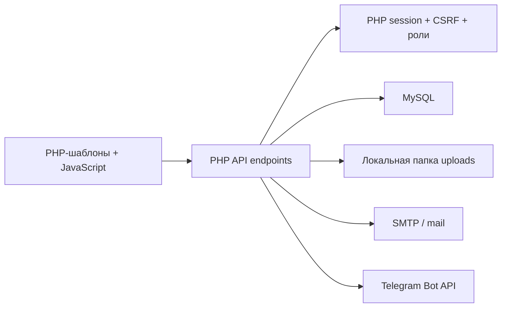

# Архитектура текущей системы

## Общая модель

Текущее приложение является серверно отданной одностраничной системой: `index.php` собирает все HTML-шаблоны, загружает базовый JavaScript и затем лениво подключает скрипты пространств. Клиент обращается к набору PHP endpoint-файлов через JSON. Состояние КП, ПКП, комплектации и конструктора документов частично хранится крупными JSON-снимками.



## Точки входа

- `index.php` собирает оболочку, пространства и модальные окна. Базовые builder-скрипты загружаются всегда, скрипты каталога, КП, документов, пользователей и настроек подключаются лениво.
- `quote.php` открывает КП/ПКП по публичному токену без авторизации, считает просмотры и принимает выбор клиента. Эта модель не переносится, потому что в новой системе публичные ссылки запрещены.
- `api/*.php` используют параметр `action` и большой `switch`, совмещая маршрутизацию, проверку прав, SQL и бизнес-логику.

## Авторизация и права

- Вход выполняется по логину и паролю через PHP-сессию.
- Пароли проверяются `password_verify`; новые пароли создаются `password_hash`.
- Все изменяющие запросы защищены CSRF-токеном.
- Сессионная блокировка освобождается перед ответами и длительными операциями через `session_write_close`.
- Роли зафиксированы в коде и enum базы: `admin`, `manager`, `rop`, `logist`, `prorab`.
- Политики ролей хранятся JSON в `role_access_policies` и определяют видимость вкладок, действия в пространствах и область видимости канбанов.
- РОП связывается с менеджерами через `rop_managers`.

В новой версии фиксированные бизнес-роли заменяются ролями внутри tenant-схемы. Системным остаётся только `system_admin`, а backend продолжает понимать стабильные ключи разрешений.

## Каталог

Каталог обслуживает категории, разделы, группы, поставщиков, единицы измерения, карточки товаров, работы и связи товар-работа. `api/catalog.php` также содержит CSV/XLSX импорт. На frontend каталог загружается с серверной пагинацией и обновляет отдельные карточки после редактирования.

Категории в актуальном дампе:

- Оборудование;
- Материалы;
- Сопутствующие расходы;
- Работы;
- Обслуживание;
- Строительные работы;
- Комплекты;
- Расходный материал.

Работы хранятся отдельно в `catalog_services`, а множественная привязка к товарам — в `product_service_links`. В дампе нет `category_scope_code`, то есть работы фактически не привязаны к категории оборудования или материалов.

## КП и ПКП

`api/kp.php` и `api/pkp.php` имеют параллельную структуру и используют общий helper `includes/quotes/quote_common.php`. Оба модуля включают каталог, компании, клиентов, сохранение предложений, канбан, статусы, архив и нормализацию payload.

Основная структура предложения:

```text
КП/ПКП
└── типы предложений
    └── варианты
        └── категории
            └── разделы
                └── позиции
```

Пользователь выбирает либо один вариант, либо целый тип предложения. Данные сохраняются одновременно в `payload_json` и в нормализованных таблицах `quote_payload_variants`/`quote_payload_items`. Для совместимости часть старых записей всё ещё содержит только `variants`.

КП умеет переносить разрешённые позиции в комплектацию. ПКП умеет переноситься в КП. Выбор заказчика и исполнителя обязателен в текущем интерфейсе. Компания-исполнитель сохраняется снимком в `company_snapshot_json`, заказчик — в `client_snapshot_json`.

## Комплектация

Комплектация хранится в `orders`, строки — в `products`, счета — в `order_invoices`. Карточки перемещаются по настраиваемому канбану. Текущая передача из КП разрешает только категории `equipment` и `materials`; расходные материалы создаются непосредственно внутри комплектации.

Комплектация содержит локальные черновики, загрузку нескольких PDF-счетов, просмотр файлов, изменение статусов и отправку PDF через email/Telegram.

## Компания

Пространство объединяет:

- профили компаний-исполнителей;
- клиентов;
- подрядчиков;
- сотрудников и пользователей;
- назначение директора.

В текущей базе клиенты и подрядчики имеют почти одинаковые таблицы. Компания может иметь несколько профилей, один из которых выбран по умолчанию.

## Документы

Конструктор документов хранит шаблон и версии шаблона. Frontend-файл `assets/js/spaces/documents.js` совмещает состояние, отрисовку, drag-and-drop, resize, пагинацию, печать и работу с блоками. Это самый крупный frontend-модуль и наиболее рискованный для прямого переноса.

Поддерживаются блоки текста, изображений, подписей, таблиц, данных компании/клиента, QR, компоновки и источников КП/ПКП. Новая версия сохраняет функциональность, но использует устойчивую документную модель с секциями, строками, колонками, контейнерами и автоматическим разрывом страниц.

## Интеграции и файлы

- Email: PHPMailer при наличии, собственный SMTP fallback и `mail()`.
- Telegram: Bot API для отправки документа.
- PDF комплектации передаётся с клиента как файл; документы частично печатаются браузером.
- Изображения документов и счета хранятся в `uploads`.
- Импорт/экспорт каталога использует CSV/XLSX.
- В коде остаются функции запроса сведений по ИНН и собственного разбора PDF; их поведение необходимо отдельно перепроектировать, но не удалять на этапе аудита.

## Основные технические риски переноса

- бизнес-логика распределена между PHP и глобальными JS-функциями;
- КП и ПКП дублируют значительный объём API;
- JSON-снимки содержат несколько исторических форматов;
- документы используют абсолютные координаты и зависят от браузерной геометрии;
- статусы и списки ролей частично зафиксированы в коде;
- `README.md`, заголовок `index.php` и комментарии дампа содержат mojibake;
- текущая публичная ссылка противоречит новой политике обязательной авторизации;
- локальная `schema.sql` на одно поле отличается от production-дампа.
