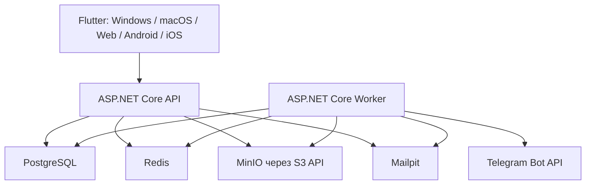

# Целевая архитектура

## Контейнеры разработки



В production те же интерфейсы подключаются к управляемым PostgreSQL/Redis, облачному S3 и почтовому провайдеру через переменные окружения. Бизнес-код не зависит от адресов контейнеров.

## Структура решения

```text
sklad-komforta/
├── src/
│   ├── backend/
│   │   ├── SkladKomforta.Api/
│   │   ├── SkladKomforta.Application/
│   │   ├── SkladKomforta.Domain/
│   │   ├── SkladKomforta.Infrastructure/
│   │   └── SkladKomforta.Worker/
│   └── flutter/
│       ├── lib/
│       ├── windows/
│       ├── web/
│       ├── android/
│       └── ios/
├── tests/
│   ├── backend-unit/
│   ├── api-integration/
│   ├── flutter-widget/
│   └── e2e/
├── compose.yaml
├── .env.example
├── migrations/
│   ├── public/
│   └── tenant/
├── scripts/
└── docs/
```

Это модульный монолит, а не набор микросервисов. Модули имеют чёткие границы, но разворачиваются как API и Worker. Для текущего масштаба это проще, быстрее и надёжнее; выделение сервиса возможно позже без изменения доменной модели.

## Модули backend

- Identity: логин, пароль, JWT, refresh-токены, TOTP, устройства, восстановление доступа.
- Tenancy: организации, членство, определение tenant-схемы, onboarding, tenant migrations.
- Authorization: определения разрешений, tenant-роли, проверки политик.
- Catalog: категории, разделы, группы, товары, работы, поставщики, единицы, импорт/экспорт.
- Company: компании, клиенты, подрядчики, сотрудники.
- Quotes: единая модель КП/ПКП, типы, варианты, позиции, расчёты, канбан, перенос ПКП в КП.
- Orders: комплектация, позиции, счета, канбан, перенос из КП.
- Documents: шаблоны, версии, блоки, рендер и PDF.
- Files: S3-объекты, метаданные, pre-signed URL, антивирусный/типовой контроль.
- Notifications: email и Telegram через очередь.
- Audit: события безопасности и business diff.

## Multi-tenant PostgreSQL

### Схема `public`

- `users`: глобальная учётная запись.
- `user_credentials`: хеш пароля и параметры смены.
- `user_mfa_methods`: TOTP и recovery codes.
- `refresh_sessions`: хеш refresh-токена, устройство, срок, отзыв.
- `organizations`: организация, состояние onboarding и имя tenant-схемы.
- `organization_members`: членство глобального пользователя в организации.
- `tenant_migrations`: версия схемы каждой организации.
- `security_audit_events`: входы, 2FA, отзыв сессий, блокировки.

### Схема tenant

- `roles`, `permissions`, `role_permissions`, `member_roles`;
- `organization_settings`, `company_profiles`;
- `workflow_boards`, `workflow_columns`;
- `field_definitions`, `field_visibility_rules`;
- `categories`, `sections`, `catalog_groups`;
- `catalog_items`, `catalog_services`, `catalog_item_services`;
- `suppliers`, `section_suppliers`, `measurement_units`;
- `clients`, `contractors`, `employees`;
- `quotes`, `proposal_types`, `quote_variants`, `quote_categories`, `quote_sections`, `quote_items`;
- `orders`, `order_items`, `order_invoices`;
- `document_templates`, `document_template_versions`, `document_blocks`;
- `file_objects`, `audit_events`, `outbox_messages`.

Tenant-схема выбирается только сервером после проверки членства. Имя схемы генерируется системой, не принимается из HTTP и подставляется в SQL только через безопасный проверенный идентификатор. Запрос должен выполняться внутри scope/транзакции с установленным `search_path`.

## Авторизация

- Access token: 15 минут.
- Refresh token: Web — 7 дней; Windows/macOS/Android/iOS — 30 дней.
- В базе хранится только хеш refresh-токена.
- Web использует защищённую HttpOnly Secure SameSite cookie для refresh-токена; access token хранится в памяти.
- Desktop/mobile используют защищённое хранилище платформы.
- TOTP обязателен по политике; секрет шифруется server-side, recovery codes хранятся хешированными.
- Каждая сессия имеет тип устройства, имя, время использования, IP/user-agent и может быть отозвана отдельно или массово.

## Redis

Redis используется для:

- краткоживущего кэша справочников с tenant-префиксом;
- rate limiting входа и TOTP;
- одноразовых challenge;
- распределённых блокировок фоновых задач;
- очереди/сигналов уведомлений, если выбран Redis-backed transport.

Redis не является источником истины для каталога, КП или прав.

## Файлы

Backend хранит в PostgreSQL метаданные и ключ объекта, а содержимое — в S3. Bucket закрыт. Pre-signed URL выдаётся только после проверки tenant, сущности и разрешения, действует одну минуту и не содержит исходного имени в ключе. MIME определяется по содержимому; размер и расширение проверяются отдельно.

## Flutter

Общими остаются domain-модели, REST-клиент, состояние, валидация и большая часть widget-дерева. Платформенными адаптерами являются безопасное хранение токенов, выбор файлов, печать/скачивание, deep links, окна и особенности навигации.

Windows реализуется первым до production-качества. Затем каждый модуль проверяется на macOS, Web, Android и iOS; архитектура и responsive-компоненты учитывают все платформы с первого экрана.

## Локализация

Начальный язык — русский. Строки интерфейса сразу выносятся в Flutter ARB-ресурсы, а бизнес-коды и статусы не используют русское отображаемое имя как идентификатор. Это небольшая первоначальная стоимость и позволяет добавить язык без переписывания экранов.
